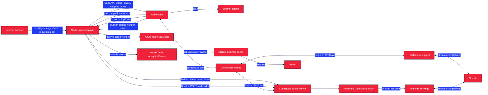

<p align="center">
  
</p>

<h1 align="center">Build a Voice AI Agent</h1>

<p align="center">
  A guided workshop for building a conversational phone agent with Twilio ConversationRelay, OpenAI, and Node.js.
</p>

<p align="center">
  <a href="https://github.com/anthonyplusAI/twilio-voice-ai/actions/workflows/ci.yml"></a>
  
  
  
</p>

<p align="center">
  <a href="#overview">Overview</a> &middot;
  <a href="#for-workshop-attendees">Attendees</a> &middot;
  <a href="#installation">Installation</a> &middot;
  <a href="#inside-the-workshop">Screenshots</a> &middot;
  <a href="#architecture">Architecture</a> &middot;
  <a href="#deployment">Deployment</a>
</p>

## Inside the Workshop

<table>
  <tr>
    <td colspan="2">
      
      <br />
      <strong>Workshop map</strong>
      <br />
      Start from a six-chapter overview that shows the learning path, outcomes, and estimated time for each stage.
    </td>
  </tr>
  <tr>
    <td width="50%">
      
      <br />
      <strong>Build an agent identity</strong>
      <br />
      Choose a preset persona or configure the agent's name, personality, greeting, voice, and language.
    </td>
    <td width="50%">
      
      <br />
      <strong>Add real capabilities</strong>
      <br />
      Toggle tools for weather, order lookup, and jokes, then test how those choices change the next call.
    </td>
  </tr>
</table>

## Overview

This repository contains the workshop experience, its six chapters of content, and a built-in voice agent runtime. Learners can follow a visual Explorer track or build the Node.js agent step by step in the Builder track.

The completed agent can place an outbound call, stream OpenAI responses through ConversationRelay, switch voices and languages, respond to keypad input, run demo tools, detect silence, and hand a call off to a human.

### Learning modes

| Mode | Intended for | Experience |
|---|---|---|
| **Explorer** | Learners who want the concepts without writing code | Visual summaries, interactive configuration, and a built-in agent |
| **Builder** | Developers building the agent | Codespaces, guided implementation, code examples, and optional solutions |

Learners choose a mode on their first visit and can switch modes from the workshop header at any time.

## For Workshop Attendees

### Prerequisites

- A GitHub account with access to [Codespaces](https://github.com/features/codespaces) for the Builder track
- A phone that can receive the workshop's test call
- Approximately 90 to 95 minutes
- An OpenAI API key from the facilitator or your own account; upgraded Twilio credentials are also needed if you use `npm run call` with your own account

Facilitated events may provide credentials at [twil.io/keys](https://twil.io/keys). Public attendees do not receive the repository's Codespaces secrets. Put a working `OPENAI_API_KEY` in `workshop/.env` before calling your Builder agent. Fill the Twilio values only if you also want to place a call from your Codespace with `npm run call`.

**Call Me on the workshop site uses the site's Twilio account**, including for Builder calls to your Codespace. `npm run call` uses the Twilio credentials in your Codespace's `workshop/.env`. Both call paths require an **upgraded Twilio account**: [current Twilio trial rules block `<ConversationRelay>`](https://www.twilio.com/docs/usage/trials/try-out-voice#blocked-verbs), even for a verified recipient. If you use your own account, [accept the Conversation Relay AI/ML features addendum](https://www.twilio.com/docs/voice/conversationrelay/onboarding#configuration-steps-in-the-twilio-console) in its Voice settings before calling.

The site's Call Me button accepts valid US and Canadian numbers. It allows one active call to a number and up to ten started calls to that number in any rolling 60 minutes. These limits apply to both Explorer and Builder calls made from the site. Calls started with `npm run call` use your Codespace's Twilio account instead.

### Getting started

1. Open the workshop URL provided by the facilitator.
2. Choose **Explorer** or **Builder** when prompted.
3. For Builder mode, [create a Codespace for this repository](https://codespaces.new/anthonyplusAI/twilio-voice-ai).
4. Add an OpenAI API key to `workshop/.env` from the facilitator's [twil.io/keys](https://twil.io/keys) instructions or your own account. The site's Call Me button needs no Twilio credentials in your Codespace. Add upgraded Twilio credentials if you also plan to run `npm run call` with your own account.
5. For `npm run call`, add your real phone number to `MY_PHONE_NUMBER` in `workshop/.env` using [E.164 format](https://www.twilio.com/docs/glossary/what-e164), such as `+12065550101` for a US-format example. The site's Call Me button asks for the number in its own form.
6. To test a live handoff in Chapter 5, set `HANDOFF_PHONE_NUMBER` to a second reachable E.164 phone number, different from the caller's phone.
7. Follow the chapter navigation in the workshop app. When Chapter 2 asks you to start your server, run `npm run dev` from `workshop/`. It restarts after you save JavaScript changes.

The dev container installs the Builder dependencies, starts a Cloudflare Quick Tunnel to the Codespace's protected proxy, and creates `workshop/.env` once. Rebuilding the container preserves your edits to that file. Codespaces terminals already open in `workshop/`; run `tunnel-url` for the public `/twiml` URL. For an optional call using your own Twilio account, open a second terminal and run `npm run call`. If you opened a terminal at the repository root, run `cd workshop` first. Keep Codespaces port `8080` private in the Ports tab: making it public bypasses the tunnel's `/call` block and WebSocket signature check.

### Workshop agenda

| # | Chapter | Outcome | Estimate |
|---:|---|---|---:|
| 1 | **Mission Briefing** | Understand the architecture and prepare the environment | 15 min |
| 2 | **First Contact** | Build the WebSocket server and make the first call | 15 min |
| 3 | **Identity** | Configure the agent's persona, voice, and language | 15 min |
| 4 | **Reflexes** | Handle interruptions, keypad input, silence, and language switching | 15 min |
| 5 | **Superpowers** | Add demo tools and live agent handoff | 20 min |
| 6 | **Launch** | Polish, deploy, and present the agent | 15 min |

Chapter estimates are pacing guides and currently total 95 minutes.

## Installation

These steps run the full companion app and its custom WebSocket server locally.

### Maintainer prerequisites

- [Node.js 22](https://nodejs.org/)
- [pnpm 10.20](https://pnpm.io/installation)
- A Twilio account SID, auth token, and voice-capable phone number for test calls
- An OpenAI API key for agent responses

### Local setup

```bash
git clone https://github.com/anthonyplusAI/twilio-voice-ai.git
cd twilio-voice-ai
pnpm install
cp .env.example .env.local
pnpm dev
```

Open [http://localhost:8080](http://localhost:8080). Edit `.env.local` before testing calls. Twilio also needs a public HTTPS and secure WebSocket URL to reach a local voice server. For the attendee Builder server, point a development tunnel at the protected proxy on port `8081`; Chapter 1 gives the local ngrok steps.

## Usage

| Command | Purpose |
|---|---|
| `pnpm dev` | Run Next.js, the voice WebSocket endpoint, and analytics on port `8080` |
| `pnpm dev:next` | Run only the Next.js development server; voice WebSockets and analytics are unavailable |
| `pnpm lint` | Run ESLint |
| `pnpm typecheck` | Run TypeScript without emitting files |
| `pnpm build` | Create the production Next.js build |
| `pnpm start` | Start the custom server using the current `NODE_ENV` |

The home page launches the workshop. Presenter slides are available at `/slides`, health status at `/health`, and workshop analytics at `/admin`.

### Facilitator preflight for a group event

- Use an upgraded Twilio account for the workshop site's Call Me button; [Twilio trials block `<ConversationRelay>`](https://www.twilio.com/docs/usage/trials/try-out-voice#blocked-verbs). The [default outbound rate](https://www.twilio.com/docs/voice/api/call-resource) is one call per second, so a burst of attendee clicks can queue.
- On that account, [accept the Conversation Relay AI/ML features addendum](https://www.twilio.com/docs/voice/conversationrelay/onboarding#configuration-steps-in-the-twilio-console) under Voice settings; account upgrade alone does not enable Conversation Relay.
- Before deploying the protected site, run [`scripts/configure-call-protection.sh`](./scripts/configure-call-protection.sh) after the Azure infrastructure setup. It creates the shared `CallLimits` and `AnalyticsEvents` tables and sets the Container App's storage, admin-password, and public-URL secrets.
- Set the deployed site's Twilio credentials and `OPENAI_API_KEY`. Set `HANDOFF_PHONE_NUMBER` to a second reachable phone if the Explorer handoff exercise should transfer.
- On the workshop-only Twilio account, verify [Voice dialing permissions](https://www.twilio.com/docs/voice/api/dialing-permissions-resources): enable low-risk **United States/Canada** only, and leave high-risk categories off. Twilio lists this combined destination as `US`; this account setting also protects calls made outside the site's Call Me button.
- Test from a fresh public attendee Codespace: fill `workshop/.env`, run `npm run dev`, copy `tunnel-url` into Call Me, change the greeting in `server.js`, save, and call again after ending the first call. Confirm the second call speaks the new greeting. The site reads the Codespace's current `/twiml` response on every Builder call and passes its supported ConversationRelay settings to Twilio. When the AI requests a handoff, the site checks the Codespace's `/call-ended` response before returning permitted dialing instructions to Twilio. Confirm that the public tunnel returns 404 for `/call` and that `npm run call` from the Codespace's `workshop/` terminal reaches a phone when a separate upgraded attendee Twilio account is configured.
- Place an Explorer call using the site's hosted agent and check the selected voice, tool, and handoff settings. If handoff is unavailable, tell attendees before the Chapter 5 exercise.

The Call Me endpoint remains public so attendees can use it without signing in. Its per-number limits reduce accidental or repeated use, but there is no site-wide daily cap; monitor Twilio usage during an event. Builder calls accept only the guided ConversationRelay TwiML and a single US or Canadian live handoff. Other TwiML verbs are refused by the shared site's Call Me button; a Codespace's public tunnel also blocks direct `/call` requests. Attendees with their own upgraded account can call through the local `npm run call` command. `/admin` and `/admin/reset-all` require HTTP Basic authentication with the organizer password. Workshop analytics events are stored in the `AnalyticsEvents` Azure Table and survive container replacements; local SQLite is rebuilt from that table for reports. Reset starts a fresh dashboard run while retaining earlier runs for recovery.

## Configuration

Copy `.env.example` to `.env.local` for the companion app.

| Variable | Required | Purpose |
|---|---:|---|
| `TWILIO_ACCOUNT_SID` | For calls | Twilio account identifier |
| `TWILIO_AUTH_TOKEN` | For calls | Twilio API credential |
| `TWILIO_PHONE_NUMBER` | For calls | Voice-capable Twilio number in E.164 format |
| `OPENAI_API_KEY` | For calls | OpenAI credential used by the built-in agent |
| `OPENAI_MODEL` | No | Chat Completions model; defaults to `gpt-5.4-nano` |
| `HANDOFF_PHONE_NUMBER` | For handoff | Human destination number in E.164 format |
| `CALL_LIMIT_AZURE_TABLE_CONNECTION_STRING` | Production calls | Connection string for the shared `CallLimits` Azure Table; set by the one-time protection script |
| `PUBLIC_BASE_URL` | Production calls | Public HTTPS origin used for Twilio call and completion callbacks; set by the one-time protection script |
| `ADMIN_PASSWORD` | Production admin | Organizer password for `/admin` and `/admin/reset-all`; set by the one-time protection script |
| `ADMIN_USER` | No | Organizer Basic Auth username; defaults to `presenter` |
| `WORKSHOP_SLIDES_EMBED_URL` | No | Published Google Slides embed URL for `/slides` |
| `PORT` | No | Custom server port; defaults to `8080` |

The attendee-built scaffold under `workshop/` uses its own `.env`. Set `MY_PHONE_NUMBER` for outbound tests and a second reachable `HANDOFF_PHONE_NUMBER`, different from the caller's phone, to test live transfers.

In local development, per-number call limits use `data/call-limits.db`. Production uses Azure Table Storage so a replacement Container App revision keeps the same limits.

## Architecture

The root app uses a custom Node.js HTTP server so Next.js routes, ConversationRelay WebSockets, and analytics share one port.



### Repository map

| Path | Responsibility |
|---|---|
| `src/app/` | Next.js pages and API routes |
| `src/content/` | Six chapters and 29 registered workshop steps |
| `src/workshop.config.ts` | Workshop metadata, branding, features, and sharing |
| `voice-agent/` | Built-in ConversationRelay and OpenAI runtime |
| `analytics/` | Event storage, dashboard queries, and PDF reports |
| `workshop/` | Starter project that Builder attendees complete |
| `.devcontainer/` | Codespaces setup and Cloudflare tunnel startup |

### Runtime endpoints

| Endpoint | Purpose |
|---|---|
| `POST /api/call` | Initiate an outbound Twilio call |
| `POST /api/call-status` | Receive signed Twilio call-completion callbacks and release active-call reservations |
| `POST /api/twiml` | Return ConversationRelay TwiML |
| `WS(S) /ws` | Exchange ConversationRelay messages with the built-in agent |
| `POST /api/events` | Ingest workshop analytics events |
| `GET /health` | Return liveness and uptime |
| `GET /admin` | Render the organizer-authenticated analytics dashboard |

## Customization

- Edit `src/workshop.config.ts` to change workshop metadata, chapter navigation, branding, themes, feature toggles, and share copy.
- Add typed content blocks under `src/content/` and register each step in `src/content/registry.ts`.
- Read the [workshop authoring guide](./WORKSHOP_AUTHORING.md) for content examples and platform conventions.
- Put app-served illustrations and icons under `public/images/`. Put README-only artwork under `docs/assets/`.

The content system is reusable, while the included API routes, voice agent, and analytics remain specific to this Voice AI workshop.

## Deployment

Pushes to `main` run lint, type checking, a production build, integration tests, and secret scanning. Pull requests also run dependency review. A successful `Validate` job builds a Docker image, pushes it to Azure Container Registry, and deploys it to Azure Container Apps with OpenID Connect (OIDC) authentication.

- [Deployment workflow and rollback](./docs/DEPLOYMENT.md)
- [One-time Azure infrastructure setup](./docs/INFRA_SETUP.md)

## Key Technologies

| Technology | Role |
|---|---|
| [Twilio ConversationRelay](https://www.twilio.com/docs/voice/conversationrelay) | Connects a phone call to the application over WebSockets and handles speech-to-text and text-to-speech |
| [Twilio Voice TwiML](https://www.twilio.com/docs/voice/twiml) | Defines call behavior and ConversationRelay configuration |
| [OpenAI Chat Completions](https://platform.openai.com/docs/api-reference/chat) | Streams model output and tool calls |
| [Next.js](https://nextjs.org/) | Renders the workshop UI and API routes |
| [GitHub Codespaces](https://github.com/features/codespaces) | Provides the Builder development environment |
| [Cloudflare Quick Tunnels](https://developers.cloudflare.com/cloudflare-one/connections/connect-networks/do-more-with-tunnels/trycloudflare/) | Gives the attendee server a temporary public endpoint |
| [Azure Container Apps](https://learn.microsoft.com/azure/container-apps/) | Hosts the production container |

## License

No license has been declared for this repository. Source availability does not grant permission to copy, modify, or redistribute the project.
