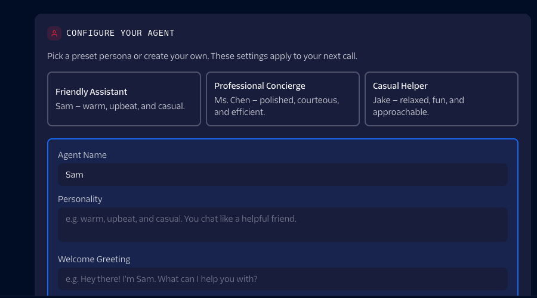
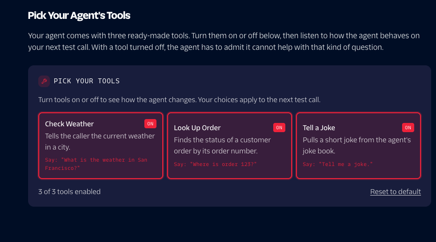
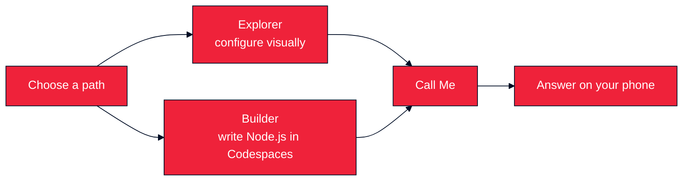
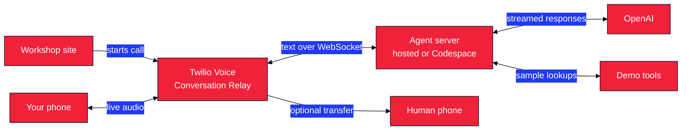

<p align="center">
  
</p>

<h1 align="center">Build a Voice AI Agent That Calls Your Phone</h1>

<p align="center">
  Make a real phone call to an AI agent you can shape. Follow six guided chapters to choose its voice, add sample tools, and explore a human handoff with Twilio Conversation Relay, OpenAI, and Node.js.
</p>

<p align="center">
  <strong>Choose a visual Explorer path or build the agent yourself in Codespaces.</strong><br />
  At a hosted event, your organizer shares the workshop link.
</p>

<p align="center">
  <a href="#start-the-workshop"><strong>How to join</strong></a> &nbsp;·&nbsp;
  <a href="https://codespaces.new/anthonyplusAI/twilio-voice-ai"><strong>Open a Builder Codespace</strong></a> &nbsp;·&nbsp;
  <a href="#run-the-companion-app-locally"><strong>Run the site locally</strong></a>
</p>

<p align="center">
  
  
  
</p>

<p align="center">
  
</p>

> **The moment it clicks:** Enter your number in **Call Me**, answer your phone, and talk to the agent you just configured. Change its greeting, voice, or tools, then call again to hear the difference.

## Watch the workshop film

<!-- Video hosted as a GitHub user attachment. -->

{{GITHUB_VIDEO_URL}}

*45-second illustrated tour of the six chapters and the call you will build.*

## What you'll do

| 01 · Make the first call | 02 · Give it a personality | 03 · Make it more capable |
|:---|:---|:---|
| Connect a phone call to an AI agent and hear a response. | Set a name, greeting, voice, and language. | Handle interruptions and keypad input, try sample tools, and optionally transfer to a person. |

The workshop site includes a reference agent for **Explorer**. In **Builder**, you write and run your own Node.js agent in a GitHub Codespace. Both paths lead to a live phone conversation through the workshop site's **Call Me** feature.

## See the workshop

<p align="center">
  <a href="./docs/assets/screenshots/home.png"></a>
  <br />
  <em>Six chapters take you from the first call to a voice agent you can demonstrate.</em>
</p>

<table>
  <tr>
    <td width="50%">
      <a href="./docs/assets/screenshots/persona-builder.png"></a>
      <br />
      <strong>Shape the conversation</strong><br />
      Choose a persona or write your own greeting and instructions.
    </td>
    <td width="50%">
      <a href="./docs/assets/screenshots/tool-picker.png"></a>
      <br />
      <strong>Hear what tools change</strong><br />
      Turn sample tools on or off, then test the next call. Weather and order responses use demo data.
    </td>
  </tr>
</table>

## Choose your path



| | Explorer | Builder |
|---|---|---|
| **Best for** | Learning how voice AI fits together without writing code | Building the WebSocket agent yourself |
| **What you do** | Configure the hosted reference agent through visual controls | Follow code steps in a Codespace, edit `workshop/server.js`, and run it |
| **What you need** | A phone that can receive a US or Canadian call | That phone, a GitHub account with Codespaces access, and an OpenAI API key |
| **What you hear** | The hosted agent with your selected settings | Your current saved agent code on the next call |

You can switch paths from the workshop header. The organizer's upgraded Twilio account powers **Call Me** for both paths; you do not need personal Twilio credentials to use that button.

## The six-chapter journey

| Chapter | What changes |
|---|---|
| **1 · Mission Briefing** | Understand the call flow and prepare your environment. |
| **2 · First Contact** | Connect the agent and make its first phone call. |
| **3 · Identity** | Choose its persona, voice, greeting, and language. |
| **4 · Reflexes** | Handle interruptions, keypad input, silence, and language changes. |
| **5 · Superpowers** | Try sample tools and an optional live transfer to a second phone. |
| **6 · Launch** | Polish the experience, explore deployment, and showcase the agent. |

Plan for roughly 90 to 95 minutes. Chapter times are pacing guides.

## Start the workshop

At a facilitated event, open the workshop URL from your organizer and choose **Explorer** or **Builder** when prompted. The site can call valid US and Canadian phone numbers.

### Explorer: start with the hosted agent

1. Select **Explorer** and follow the chapter cards.
2. Use **Call Me** to answer a call from the hosted agent.
3. Change the persona, voice, language, or sample tools and call again.

Explorer needs no Codespace or personal API keys when the organizer has configured the workshop site.

### Builder: make the call run your code

1. Select **Builder** and [create a Codespace for this repository](https://codespaces.new/anthonyplusAI/twilio-voice-ai).
2. Add an `OPENAI_API_KEY` to `workshop/.env`. Your organizer may supply one; public Codespaces do not inherit this repository's secrets.
3. Follow the workshop steps to create `workshop/server.js`. When Chapter 2 asks you to start the server, run `npm run dev` from `workshop/`. The Codespace terminal normally opens there.
4. Run `tunnel-url` to get your current public `/twiml` URL. Paste it into the workshop site's **Call Me** form, enter your phone number, and answer the call.
5. Edit and save `workshop/server.js`, then call again to hear your change. The development server restarts after JavaScript edits.

The Codespace sets up a Cloudflare Quick Tunnel through a protected proxy. **Keep Codespaces port `8080` private** in the Ports tab; the tunnel is the intended public route.

For a Builder live handoff in Chapter 5, set `HANDOFF_PHONE_NUMBER` in `workshop/.env` to a second reachable E.164 number, different from the caller's number. Restart `npm run dev` after changing `.env`. Explorer handoff depends on the organizer's site configuration.

<details>
<summary>Optional: call from your own Twilio account</summary>

The site's **Call Me** button uses the organizer's Twilio account. To initiate a call from your Codespace with `npm run call`, add `TWILIO_ACCOUNT_SID`, `TWILIO_AUTH_TOKEN`, `TWILIO_PHONE_NUMBER`, and your [E.164](https://www.twilio.com/docs/glossary/what-e164) `MY_PHONE_NUMBER` (for example, `+12065550101`) to `workshop/.env`. Run `npm run call` from `workshop/` in a second terminal.

Your own account must be upgraded because [Twilio trial accounts block the `<ConversationRelay>` TwiML noun](https://www.twilio.com/docs/usage/trials/try-out-voice#blocked-verbs). Accept the [Conversation Relay AI/ML features addendum](https://www.twilio.com/docs/voice/conversationrelay/onboarding#configuration-steps-in-the-twilio-console) before placing a call.

</details>

## How a call works

Twilio Voice places the call. [Conversation Relay](https://www.twilio.com/docs/voice/conversationrelay) handles speech recognition and speech synthesis, then exchanges text with the agent over a WebSocket. The hosted agent or your Builder server streams OpenAI responses and can use sample tools. An optional handoff transfers the call to a configured human number.



The repository contains the workshop site, the hosted reference agent, and the Builder starter project. It is a learning environment: the weather and order tools use sample data, and Chapter 6 introduces deployment rather than deploying each attendee's Codespace automatically.

## Run the companion app locally

The repository root runs the workshop site and its built-in voice agent. The attendee project is in `workshop/`.

**To preview the site:** Node.js 22 and pnpm 10.20. **To test real calls:** an OpenAI API key plus an upgraded Twilio account with a voice-capable number and the [Conversation Relay addendum accepted](https://www.twilio.com/docs/voice/conversationrelay/onboarding#configuration-steps-in-the-twilio-console).

```bash
git clone https://github.com/anthonyplusAI/twilio-voice-ai.git
cd twilio-voice-ai
pnpm install
cp .env.example .env.local
pnpm dev
```

Open [http://localhost:8080](http://localhost:8080). Fill in `.env.local` before testing calls. Twilio needs public HTTPS and secure WebSocket endpoints to reach a local voice server; Chapter 1 covers the development tunnel for the Builder project.

| Command | Purpose |
|---|---|
| `pnpm dev` | Run the workshop site, voice WebSocket, and analytics on port `8080` |
| `pnpm dev:next` | Run the Next.js UI only, without voice WebSocket or analytics |
| `pnpm lint` / `pnpm typecheck` | Check source quality and types |
| `pnpm test` | Build and run the integration tests |
| `pnpm build` / `pnpm start` | Build and start the custom server |

The home page launches the workshop. Presenter slides are at `/slides`, health status is at `/health`, and the organizer's analytics dashboard is at `/admin`.

<details>
<summary>Companion app environment variables</summary>

Copy `.env.example` to `.env.local`. The Builder starter has a separate `workshop/.env`.

| Variable | When needed | Purpose |
|---|---|---|
| `TWILIO_ACCOUNT_SID`, `TWILIO_AUTH_TOKEN`, `TWILIO_PHONE_NUMBER` | Real calls | Twilio credentials and voice-capable source number |
| `OPENAI_API_KEY` | Agent responses | OpenAI credential for the hosted agent |
| `OPENAI_MODEL` | Optional | Chat Completions model; defaults to `gpt-5.4-nano` |
| `HANDOFF_PHONE_NUMBER` | Live handoff | Second reachable E.164 phone number |
| `CALL_LIMIT_AZURE_TABLE_CONNECTION_STRING` | Production calls | Azure Table connection for shared call limits and analytics events |
| `PUBLIC_BASE_URL` | Production calls | Public HTTPS origin for Twilio callbacks |
| `ADMIN_PASSWORD` | Production dashboard | Password for `/admin` and `/admin/reset-all` |
| `ADMIN_USER` | Optional | Dashboard username; defaults to `presenter` |
| `WORKSHOP_SLIDES_EMBED_URL` | Optional | Published Google Slides embed URL for `/slides` |
| `PORT` | Optional | Custom server port; defaults to `8080` |

Local call limits use `data/call-limits.db`; production uses Azure Table Storage so limits survive a container replacement.

</details>

## For facilitators and maintainers

- [Facilitator guide](./docs/FACILITATOR_GUIDE.md) — account readiness, call paths, a full attendee test, and day-of controls.
- [Deployment and rollback](./docs/DEPLOYMENT.md) — Azure Container Apps release flow and health checks.
- [One-time infrastructure setup](./docs/INFRA_SETUP.md) — Azure resources, GitHub configuration, and call protection.
- [Workshop authoring guide](./WORKSHOP_AUTHORING.md) — add content blocks and adapt the workshop experience.

| Path | What it contains |
|---|---|
| `src/app/`, `src/content/` | Next.js pages, API routes, and 29 workshop steps |
| `src/workshop.config.ts` | Workshop metadata, chapter navigation, branding, and feature settings |
| `voice-agent/` | Hosted Conversation Relay and OpenAI runtime |
| `workshop/` | Builder starter project |
| `.devcontainer/` | Codespaces setup and protected tunnel |
| `analytics/` | Event storage, dashboard queries, and reports |

To adapt the workshop, edit `src/workshop.config.ts` and register new content in `src/content/registry.ts`. The [authoring guide](./WORKSHOP_AUTHORING.md) covers the content blocks.

<details>
<summary>Runtime endpoints</summary>

| Endpoint | Purpose |
|---|---|
| `POST /api/call` | Start an outbound Twilio call |
| `POST /api/call-status` | Receive signed call-completion callbacks and release active-call reservations |
| `POST /api/twiml` | Return Conversation Relay TwiML |
| `POST /api/connect-action` | Handle a signed handoff action |
| `WS(S) /ws` | Exchange Conversation Relay messages with the hosted agent |
| `POST /api/events` | Receive workshop analytics events |
| `GET /health` / `GET /health/analytics` | Report app and analytics health |
| `GET /admin` | Show the organizer's authenticated analytics dashboard |

</details>

## License

No license has been declared for this repository. Source availability does not grant permission to copy, modify, or redistribute the project.
